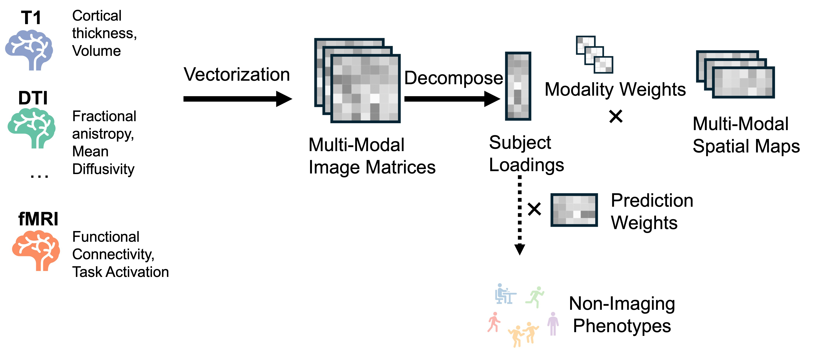

# SuperBigFLICA (SBF)

[](https://www.python.org/)
[](LICENSE)
[](http://dx.doi.org/10.1002/dad2.70360)

> **Semi-supervised multimodal neuroimaging data fusion** that simultaneously learns interpretable spatial brain components and predicts clinical outcomes — enabling both discovery and prediction from multi-modal brain imaging data.

<p align="center">
  
</p>

## Features

- Semi-supervised multimodal brain imaging fusion via joint matrix decomposition
- Simultaneously learns interpretable spatial brain components and predicts clinical outcomes
- Supports NIfTI (`.nii.gz`), FreeSurfer surface (`.mgh`), CIFTI (`.dtseries.nii`), and plain text matrix (`.txt`) inputs
- Train / validation / test split workflow with per-epoch validation tracking
- Saves spatial component maps in native file formats for direct use in neuroimaging tools

## Citation

SuperBigFLICA was originally proposed in:

> **Supervised Phenotype Discovery From Multimodal Brain Imaging**
> Weikang Gong, Shuang Bai, Yong-Qiang Zheng, Stephen M. Smith, Christian F. Beckmann
> *IEEE Transactions on Medical Imaging*, 42(3):834–849, 2023. https://doi.org/10.1109/TMI.2022.3218720

```bibtex
@article{gong2023supervised,
  title={Supervised Phenotype Discovery From Multimodal Brain Imaging},
  author={Gong, Weikang and Bai, Shuang and Zheng, Yong-Qiang and Smith, Stephen M. and Beckmann, Christian F.},
  journal={IEEE Transactions on Medical Imaging},
  volume={42},
  number={3},
  pages={834--849},
  year={2023},
  doi={10.1109/TMI.2022.3218720}
}
```

If you use this codebase in your research, please also cite:

> **Investigating the Amyloid-Tau-Neurodegeneration Framework in Alzheimer's Disease Using Semi-Supervised Multimodal Imaging Data Fusion**
> You Cheng, Adrián Medina, Cole Korponay, Christian F. Beckmann, David Harper, Lisa Nickerson, and the Alzheimer's Disease Neuroimaging Initiative
> *Alzheimer's & Dementia: Diagnosis, Assessment & Disease Monitoring*, 2026. https://doi.org/10.1002/dad2.70360

```bibtex
@article{cheng2025sbf,
  title={Investigating the Amyloid-Tau-Neurodegeneration Framework in Alzheimer's Disease Using Semi-Supervised Multimodal Imaging Data Fusion},
  author={Cheng, You and Medina, Adri{\'a}n and Korponay, Cole and Beckmann, Christian F. and Harper, David and Nickerson, Lisa and {Alzheimer's Disease Neuroimaging Initiative}},
  journal={Alzheimer's \& Dementia: Diagnosis, Assessment \& Disease Monitoring},
  year={2026},
  doi={10.1002/dad2.70360},
  url={http://dx.doi.org/10.1002/dad2.70360}
}
```

## Requirements

**Python:** ≥ 3.11 (Linux) / ≥ 3.10 (macOS)

**Python packages** (see `requirements.txt` / `requirements.macos.txt`):
- `torch`, `numpy`, `nibabel`, `scipy`, `scikit-learn`, `pandas`, `matplotlib`, `joblib`

**External tools** (must be installed and on PATH):
- [FSL](https://fsl.fmrib.ox.ac.uk/) — required for MNI152 brain mask (NIfTI modalities)
- [FreeSurfer](https://surfer.nmr.mgh.harvard.edu/) — required for `.mgh` surface file processing

## Getting Started

### 1. Install dependencies

```bash
pip install -r requirements.txt         # Linux (Python ≥ 3.11)
pip install -r requirements.macos.txt   # macOS (Python ≥ 3.10)
```

### 2. Set environment variables

```bash
export FSLDIR=/path/to/fsl
export FREESURFER_HOME=/path/to/freesurfer
export FSAVERAGE_PATH=/path/to/fsaverage
```

### 3. Configure and run

Edit `Scripts/SBF.py` to set your data paths and parameters, then:

```bash
python Scripts/SBF.py
```

For SLURM cluster submission, use `Scripts/RUN_SBF_sbatch.sh`.

## Data Structure

The root data folder (`opts["brain_data_main_folder"]` in `Scripts/SBF.py`) should contain one subfolder per modality per split, plus behavioral CSV files:

```
<data_folder>/                                    # e.g., ../forKayla/
├── nIDPs_train_totalMJ.csv                      # Behavioral targets — train
├── nIDPs_validation_totalMJ.csv                 # Behavioral targets — validation
├── nIDPs_test_totalMJ.csv                       # Behavioral targets — test
├── <MODALITY>_train/
│   └── <data_file>.(nii.gz|mgh|dtseries.nii|txt)
├── <MODALITY>_validation/
│   └── <data_file>.(nii.gz|mgh|dtseries.nii|txt)
└── <MODALITY>_test/
    └── <data_file>.(nii.gz|mgh|dtseries.nii|txt)
```

Outputs are written to `opts["output_dir"]` (default: `Data/SBF_outputs/`):

```
Data/SBF_outputs/
├── SBFOut_<MODALITY>.nii.gz        # Spatial component maps (NIfTI)
├── SBFOut_lh_<MODALITY>.mgh        # Left-hemisphere component maps (FreeSurfer surface)
├── SBFOut_rh_<MODALITY>.mgh        # Right-hemisphere component maps (FreeSurfer surface)
├── SBFOut_<MODALITY>.dtseries.nii  # Spatial component maps (CIFTI)
├── lat_train.csv                   # Latent components — training set
├── lat_test.csv                    # Latent components — independent test set
├── pred_valid.csv                  # Predicted nIDPs — validation set (best epoch)
├── pred_train.csv                  # Predicted nIDPs — training set (best model)
├── pred_test.csv                   # Predicted nIDPs — independent test set (best model)
├── modality_weights.csv            # Per-modality contributions to each latent component
├── prediction_weights.csv          # Weights mapping latent components to nIDPs
├── SBF_best_model.pth              # Model checkpoint with best validation performance
├── SBF_final_model.pth             # Model checkpoint from the final training epoch
├── loss_all_test.csv               # Per-epoch validation loss (4 components)
├── test_corr.txt                   # Best Pearson r on the validation set (used to select best model)
├── best_performance.csv            # Pearson r on the independent test set using the best model
└── order_of_loaded_data.txt        # Log of data file loading order
```

### Output file descriptions

| File | Description |
|------|-------------|
| `SBFOut_<MODALITY>.*` | Spatial component maps for each modality. Each map has `nlat` components; voxel/vertex values are spatial loadings from regressing `lat_train` onto the original imaging data. One file per modality in the modality's native format (`.nii.gz`, `.mgh`, or `.dtseries.nii`). |
| `lat_train.csv` | Multimodal shared latent components for training subjects (subjects × `nlat`). Use these to correlate or predict other nIDPs not used during training. |
| `lat_test.csv` | Multimodal shared latent components for independent test subjects (subjects × `nlat`), produced by applying the best model to the test set. |
| `pred_valid.csv` | Predicted nIDPs for validation subjects at the epoch that achieved the best validation correlation. This is the output of the training loop's internal validation. |
| `pred_train.csv` | Predicted nIDPs for training subjects using the best model. |
| `pred_test.csv` | Predicted nIDPs for independent test subjects using the best model. |
| `modality_weights.csv` | `nlat` × modality matrix. Each value is the contribution (softmax-normalized weight) of a modality to a given latent component. |
| `prediction_weights.csv` | `nlat` × `#nIDPs` matrix. Trained linear weights mapping latent components to predicted nIDPs. |
| `SBF_best_model.pth` | PyTorch state dict for the model epoch that achieved the highest validation correlation. Use this for downstream inference. |
| `SBF_final_model.pth` | PyTorch state dict from the last training epoch (may not be the best-performing epoch). |
| `loss_all_test.csv` | Per-epoch validation loss broken into 4 components: reconstruction loss, spatial loading regularization, MSE prediction loss, and prediction weight regularization. |
| `test_corr.txt` | Best Pearson r achieved on the **validation set** during training. For a single nIDP this is the correlation; for multiple nIDPs it is the sum of per-target correlations exceeding 0.1. This value is used to select `SBF_best_model.pth`. |
| `best_performance.csv` | Pearson r between predicted and actual nIDPs on the **independent test set**, computed post-training using `SBF_best_model.pth`. One value per nIDP. This is the held-out generalization metric. |
| `order_of_loaded_data.txt` | Log of the file paths and order in which imaging data were loaded. Useful for debugging modality alignment. |

## Project Structure

```
SuperBigFLICA_McL/
├── Scripts/                # Main scripts (SBF.py, sbf_utils.py, RUN_SBF_sbatch.sh)
├── Data/                   # Input data folder
├── figures/                # Overview figures
├── Slides/                 # Presentation materials
├── Visualizations/         # Output visualization utilities
├── model_cards/            # Documentation for trained models
├── requirements.txt        # Linux dependencies
└── requirements.macos.txt  # macOS dependencies
```

## Model Cards

Pre-trained model documentation:

- [SBF CDR-SOB ADNI3](model_cards/sbf_cdrsob_adni3_MODEL_CARD.md) — SuperBigFLICA trained on ADNI3 multimodal neuroimaging to predict Clinical Dementia Rating Sum of Boxes (CDR-SOB)

## License

This project is licensed under the MIT License — see [LICENSE](LICENSE) for details.
